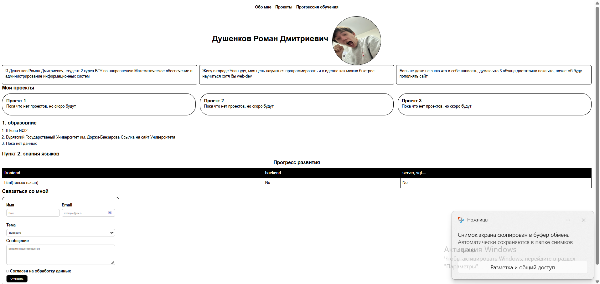

# Personal Portfolio Website

This is my personal web-portfolio. Adaptive site with information about me, education, skills and contacts

## Live Demo
[https://r0dush.github.io/web-dev/](https://r0dush.github.io/web-dev/)

## Screenshot

## Built with
- HTML5 (Semantic markup)
- CSS3 (flexbox, Grid, CSS variables)
- Responsive design (mobile-first)
- Dark theme support

## Features
- Sticky navigation bar
- Responsive hero section
- About me cards
- Projects grid
- Contact form
- Dark theme via CSS variables

## Project Structure
***
web-dev/
├── images/
│ └── photo.jpg
├── index.html
├── style.css
└── README.md
***

## Author
**Roman Dushenkov**
- GitHub: [@r0dush](https://github.com/r0dush)
- VK: [vk.com/vhjhbdc](https://vk.ru/vhjhbdc)
- Email: rudivit@list.ru

## Progress

The project was created during my web development learning process:

- [x] Day 1–3: HTML basics
- [x] Day 4–6: CSS (typography, flexbox, grid, responsive)
- [x] Day 7: CSS variables, dark theme, deploy
- [ ] Day 8–14: JavaScript basics
- [ ] Day 15+: React, backend